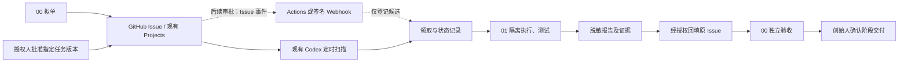

# CG-AUTO-ORCHESTRATION-V1｜China Guide 自动协作调度设计

交付状态：设计完成，待 00 号独立验收。分支 docs/cg-phase1-collaboration，基线 1a6b783cec777ba0baa9fbb3fa2a11c337469860。本提交仅新增本文，提交 SHA 见固定链接。继承 [上一版方案](CG-COLLAB-AUTOMATION-PLAN.md)。

## A. 当前能力与验收范围

| 能力 | 已核实结果 |
|---|---|
| Projects、Issue、执行回报 | 现有看板可用。Issue #2 验证 01 从看板读取、回填，00 通过 GitHub 独立验收。登记使用现有登录会话。 |
| 通知 | Issue #3 提及已建立，站内通知与邮件实际送达均无收件方证据。 |
| Codex heartbeat | 北京时间 2026-11-14 16:51:12 读取批准的 Issue #3 并生成本机标准报告；16:54:12 再读 #3，命中完成记录，跳过目标评论检查并保留原报告。临时任务已删除，证据已交 00，未取得该项独立验收结论。22:00 汇总仍为另一用途。 |
| 状态脚本 | 本轮运行现有 check-collaboration.mjs，退出码 0，校验两条本地草稿记录。脚本检查表格字段及重复编号，不调度任务。 |
| Actions 与自动回写 | 现有工作流是本地草稿。当前连接的 Issue 写入尝试曾返回 403，无已验收的无人值守回写。 |

[看板派单与回报](https://github.com/baicheng999/cn-guide/issues/2#issuecomment-6874592052) · [通知测试](https://github.com/baicheng999/cn-guide/issues/3#issuecomment-6874642752)。本机定时证据以原报告与去重记录为准，GitHub 可独立验证源 Issue 和评论。

## B. 推荐架构

GitHub Issue 保存派单与审批引用，现有 task-board.json 继续作为内部阶段状态来源。调度记录保存领取租约、重试次数及回报状态，避免建立第二份业务看板。

## C. 触发、领取与连续执行

- 首选桌面定时读取，试运行建议工作时段每 30 分钟检查一次。电脑和应用在线时处理，关机后恢复先查漏单。公开文档列出 GitHub PR 活动入口，未列出新 Issue 直接唤醒当前 Codex 会话的能力。[Codex 定时任务](https://learn.chatgpt.com/docs/automations)
- 后续若需要实时入队，GitHub issues opened/edited/labeled 仅登记或更新候选。Actions 的 issues 工作流须存在于默认分支，需另审。Webhook 方案由受控接收端验证签名、限定仓库、记录 delivery ID 后再排队。执行须独立接入 Codex。保留定时补扫，弥补事件漏投。[Actions 事件](https://docs.github.com/en/actions/reference/workflows-and-actions/events-that-trigger-workflows#issues) · [Webhook 签名](https://docs.github.com/en/webhooks/using-webhooks/validating-webhook-deliveries) · [Codex GitHub Action](https://learn.chatgpt.com/docs/github-action)
- 领取前检查批准人白名单、批准版本、任务范围、阶段、依赖、测试命令和预期基线。审批绑定结构化任务摘要哈希，任务实质变化后重新批准。标签只是候选提示。
- 队列按 P0→P3 排序，同优先级先批准先执行。依赖已通过才可领取。发现循环依赖标 BLOCKED。每次单并发、最多两项或 30 分钟，先到即停。同阶段只有原授权内的普通任务可连续领取，阶段结论由 00 核验，下一阶段等待创始人确认。

## D. 权限、恢复、回报与安全

- 使用「仓库＋Issue 编号＋批准版本」作为唯一键，用原子领取和有期限的租约防止双领。状态依次为候选、已领取、执行中、报告已保存、待回传、待验收。回传失败仅重试回传，按任务键查找已有评论，避免重复写入。租约过期先查证据和副作用，再决定续跑。
- 仅网络超时、限流和临时服务故障自动重试，按服务提示或退避，最多两次。权限不足、依赖缺失或副作用不明立即阻塞。结果评论及自动化自身事件不参与领单。
- 01 自动生成八项标准交付报告。首轮使用现有获准方式按次回填，自动回传以后另审，专用身份仅能写指定仓库 Issues，无代码或部署权限。00 在原 Issue 核验并给出 PASS、PARTIAL、BLOCKED 或 NEEDS HUMAN。阻塞在当前会话即时显示并纳入既有晚间汇总；即时通知须有收件方证据。
- 暂停时停止领取，当前步骤到安全点保存证据。紧急停止可禁用定时入口或接收端。恢复时核对批准仍有效、租约、报告与回传记录，只接续未完成步骤。
- Issue、评论和附件均视为外部资料，执行器只使用允许的命令与隔离工作目录，报告脱敏后才共享。生产部署、数据库迁移、资金、真实客户数据和重大规则均须创始人单独批准。执行器不持有生产凭证。阶段报告汇总任务验收、测试、版本、截图或日志、遗留与回退；未过阶段门槛不得自动跨阶段。

## E. 月成本估算

首期复用现有电脑、GitHub 和 Codex，新增第三方服务与付费 API 预算为 0。按工作日 22 天、每天 8 小时、每半小时扫描估算，每月约 352 次读取扫描，实际执行次数另计。Codex 用量、用电及在线时间需实测。第二阶段若审批使用 Actions 或事件接收端，先按运行分钟、模型用量、日志与托管量核价，再设月上限和达到上限即暂停。未计入未获批准的外部服务。

## F. 实施阶段与工作量

1. **隔离轮询与审批校验，1–2 人日。** 先用现有定时入口和单条 TEST，补任务版本绑定、租约及证据。
2. **报告、阻塞与暂停恢复，2–3 人日。** 验收重启去重、失败只重试回传、00 独立核对。
3. **可选即时事件与自动回写，2–4 人日。** 仅在轮询稳定且创始人批准后评估。先验证真实通知，再决定是否上线长期运行。

## G. 最小可行测试

复用 Issue #3，仅获准读取 Issue #1 评论 6874444807。两次定时读取应产生一次执行、一个报告和一条跳过记录；用未批准或修改后未重批的 TEST 确认拒绝领取。用合成状态分别演练并发双领、依赖未通过、临时失败、暂停与恢复、回填失败后仅重试回填。由 00 独立读 GitHub 源记录，定时日志、去重与收件回执分别列证。当前只交付设计，未部署调度器、未调用付费 API，未变更生产。
